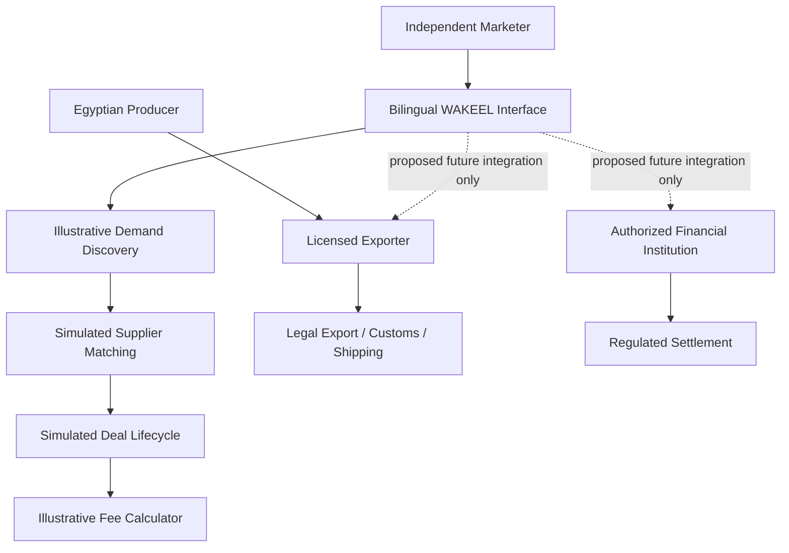

# WAKEEL EXPORT

**An independent proposal for participatory Egyptian export enablement — not a government agency, official portal, approved programme, or operational export service.**

[](https://nodejs.org/)
[](prototype/README.md)
[](#8-testing--verification)
[](#proof-of-concept--enterprise-customization-readiness)

**From Egyptian producers to international markets, with independent marketers connecting demand while licensed exporters retain legal export execution.**

The repository contains a bilingual initiative explainer, a separate interactive WAKEEL Lite prototype, preliminary feasibility and financial documentation, evidence registers, and an institutional decision brief. All product interactions and commercial figures in the prototype are illustrative unless explicitly identified as official historical data.

## 1. Project Overview & Problem Statement

Many Egyptian producers need wider access to international buyer demand, while individuals interested in export marketing may lack the legal status, operational infrastructure, and capital required to act as exporters.

WAKEEL proposes a role-separated model:

- Egyptian manufacturers and producers provide eligible products and fulfilment capability.
- Independent marketers introduce and develop buyer demand under a proposed contractual framework.
- Licensed export entities retain the legal Exporter of Record role and handle export documentation, customs, settlement, and shipping.
- Regulated financial institutions handle payment and settlement functions within their legal scope.

### Proposal indicators — not operational results

- First-year mobilisation target: 100,000 independent marketer registrations; not a forecast of active users, jobs, or completed transactions.
- Proposed fee allocation: 0.5% marketer + 0.1% platform (0.6% total), subject to legal, tax, regulatory, and contractual approval.
- Official national context: Egypt's non-oil exports were reported at USD 48.567 billion in 2025.
- A proposed 15% increase is an ambitious scenario/target, not a government forecast or a result attributable to WAKEEL.

No live buyer, supplier, KYC, payment, bank, customs, shipping, grant, or government integration is claimed.

### Architecture



The current prototype implements only the front-end demonstration path. The legal export, banking, KYC, and institutional paths above are proposed operating-model boundaries, not integrated services.

## 2. Tech Stack & Versions

| Area | Technology |
|---|---|
| Root initiative explainer | HTML5, CSS3, JavaScript, bilingual Arabic RTL / English LTR |
| WAKEEL Lite prototype | Native HTML, CSS, JavaScript |
| PWA support | Web App Manifest and scoped Service Worker cache |
| Runtime dependencies | None for the prototype; no remote runtime library or paid API |
| Test runner | Node.js built-in `node:test` |
| CI | GitHub Actions with Node.js 22 |
| Static hosting | GitHub Pages |
| Research and governance | Markdown, HTML, JSON, funding/source registers |

The root `package.json` is private and defines only `npm test` using Node's built-in test runner. No third-party npm package is declared.

## 3. Prerequisites & Dependencies

- Git.
- A modern browser.
- Node.js 22 and npm to run the automated prototype tests.
- A local HTTP server or HTTPS hosting to test service-worker/PWA behavior reliably.

No database, backend server, API key, login, paid service, or cloud account is needed to open the static prototype.

## 4. Installation & Local Setup

Clone the repository:

```bash
git clone https://github.com/zopair/WAKEEL.git
cd WAKEEL
```

Run the prototype smoke tests:

```bash
npm test
```

Serve the repository locally:

```bash
python -m http.server 8000
```

Open the root initiative explainer:

`http://localhost:8000/`

Open the separate interactive Lite prototype:

`http://localhost:8000/prototype/`

The Lite prototype supports Arabic/English switching, simulated demand discovery, supplier matching, deal-state progression, and an illustrative fee calculator. Its service-worker cache is scoped to the prototype and is intended to work after the first successful visit over HTTPS or localhost.

## 5. Environment Variables

**No environment variables or secrets are required by the current static prototype or its test suite.**

The GitHub Actions deployment workflow uses the repository-scoped GitHub Pages permissions and the workflow token supplied by GitHub. It does not require KDP, banking, government, buyer, supplier, or payment credentials.

Do not add real customer information, buyer lists, bank credentials, KYC documents, payment data, or third-party session cookies to this public repository.

## 6. Usage Guide & Core Features

### A. Root initiative explainer

The root `index.html` is the bilingual initiative explainer. It presents the proposed role separation, national context, impact assumptions, institutional framework, and illustrative calculations.

Important boundary: the current Pages deployment workflow uploads `prototype/` as the site root. It does not publish the repository-root `index.html`. The root explainer is available in the repository and can be previewed locally; publishing it requires an intentional deployment-path change.

### B. WAKEEL Lite interactive prototype

Open [`prototype/index.html`](prototype/index.html). The prototype demonstrates:

- Arabic RTL / English LTR language switching.
- Mobile-first responsive layout.
- CSS-rendered Egyptian flag animation and reduced-motion support.
- Illustrative demand leads, buyer search, and status filters.
- Simulated supplier matching and RFQ creation.
- Simulated deal lifecycle: matching → quoted → confirmed → shipped → completed.
- Fee calculator using the proposed 0.5% marketer and 0.1% platform split.
- Installable static PWA shell and offline app-shell cache after the first successful load.

All buyers, suppliers, metrics, prices, deal states, and workflow events are sample data. Buttons do not create real commercial transactions.

See [Prototype README](prototype/README.md) for the complete interaction and architecture notes.

### C. Feasibility, operating model, and institutional documents

| Document | Purpose |
|---|---|
| [Preliminary Feasibility Assessment](docs/FEASIBILITY_STUDY.md) | Desk assessment and outstanding primary research |
| [Review Report](docs/REVIEW_REPORT_2026-11-19.md) | Review findings and evidence gaps |
| [Arabic Decision Brief](docs/DECISION_BRIEF_AR.md) | Institutional study request only; no launch, contract, or funding request |
| [Research Validation Plan](docs/RESEARCH_VALIDATION_PLAN.md) | Demand intelligence, market sizing, and validation methodology |
| [Operating Model](docs/OPERATING_MODEL.md) | Roles, transaction lifecycle, and legal boundaries |
| [Financial Model](docs/FINANCIAL_MODEL.md) | Preliminary assumptions; not an approved budget or contract |
| [Sources & Assumptions](docs/SOURCES_AND_ASSUMPTIONS.md) | Historical data, assumptions, source links, and limitations |
| [Impact Measurement Framework](docs/IMPACT_MEASUREMENT_FRAMEWORK.md) | Proposed KPIs, attribution, inclusion, and environmental measurement |
| [International Funding Opportunities](docs/INTERNATIONAL_FUNDING_OPPORTUNITIES.md) | Dated funding-call register and eligibility notes |
| [Funding & Government Framework](docs/FUNDING_AND_GOVERNMENT_FRAMEWORK.md) | Future institutional options and donor/beneficiary separation |
| [IP & Provenance Record](docs/IP_AND_PROVENANCE.md) | Authorship statement and limits of GitHub as legal evidence |
| [Documentation Index](docs/README.md) | Full document catalogue |

Funding opportunities are research references only. The repository does not evidence a grant award, current funding commitment, institutional partnership, or submitted application.

### D. GitHub Pages deployment

The workflow `.github/workflows/deploy-pages.yml` deploys the contents of `prototype/` to GitHub Pages when prototype files or the workflow change on `main`, or when manually dispatched. A successful deployment run was recorded on 19 November 2026.

Configured Pages URL: [WAKEEL Lite](https://zopair.github.io/WAKEEL/).

The current deployment path serves the Lite prototype as the Pages root; it does not serve the root `index.html` initiative explainer. Confirm the deployment status in Actions before relying on the URL as a live service.

## 7. Live Demo & Screenshots

- **WAKEEL Lite Pages destination:** [https://zopair.github.io/WAKEEL/](https://zopair.github.io/WAKEEL/)
- **Root initiative explainer source:** [`index.html`](index.html)
- **Interactive prototype source:** [`prototype/index.html`](prototype/index.html)

The repository tree reviewed for this update contains `video/README.md` but no video asset. Therefore, the previously described 32-second walkthrough is not included as a tracked deliverable in the current tree.

No screenshots or visuals in the repository should be interpreted as evidence of live export transactions, verified buyers, government approval, awarded funding, or operational partnerships.

## 8. Testing & Verification

Run the automated smoke tests with Node.js 22:

```bash
npm test
```

The current tests verify:

- Arabic RTL and English language switching hooks.
- Animated flag and mobile-first layout markers.
- Simulated demand matching, deal states, and fee values.
- PWA manifest and scoped offline app-shell caching.
- Absence of remote runtime dependencies in the Lite prototype HTML.

### CI evidence observed during this review

- **Prototype checks:** latest observed main-branch run on 20 November 2026 — Success.
- **Deploy WAKEEL Lite to GitHub Pages:** observed deployment run on 19 November 2026 — Success.
- These are historical workflow results. This README-only update does not claim a new prototype test or deployment run.

The smoke tests are static/source-level checks. They do not validate real buyers, supplier onboarding, banking, KYC, payment settlement, customs, export compliance, mobile-device compatibility across all browsers, or regulatory approval.

## Proof of Concept & Enterprise Customization Readiness

**Status: Proposal + static PoC.** The bilingual interface and local simulation exist; the export ecosystem itself is not operational.

| Capability | Current state |
|---|---|
| Initiative explainer | Root static HTML source; not included in current Pages deployment path |
| WAKEEL Lite UI | Implemented static bilingual prototype |
| Demand and supplier matching | Illustrative local simulation only |
| Deal lifecycle | Simulated states; no transaction persistence or backend |
| Fee calculation | Illustrative calculation using proposed fee allocation |
| PWA | Manifest and scoped service-worker app-shell cache implemented |
| Market demand | Primary buyer/RFQ validation outstanding |
| Supplier readiness | No verified supplier capacity/quality catalogue evidenced |
| KYC, banking, settlement | Not implemented |
| Licensed exporter / customs / shipping | Not integrated |
| Government / TradeTech Sandbox | No approval, official status, or partnership evidenced |
| Grant funding | No award or disbursement evidenced |
| Legal and tax model | Proposed only; independent Egyptian legal/tax review required |
| Walkthrough video | No video file present in the reviewed repository tree |
| License | No root `LICENSE` file was present in the reviewed tree; clarify project and third-party terms before redistribution |

### Release and institutional decision gates

1. Complete primary research with verifiable buyers, RFQs, suppliers, and exportable product categories.
2. Validate TAM/SAM/SOM by product HS code and target market using official trade data.
3. Obtain written Egyptian legal/tax/regulatory review for marketer status, fees, contracts, KYC, settlement, and data handling.
4. Identify licensed exporter and regulated financial partners only through documented, authorized engagement.
5. Validate the operating economics using current quotations and explicit assumptions.
6. Obtain owner and institutional approval before any pilot, funding application, public launch, or commercial transaction.

The proposal is suitable for institutional study and evidence development; it must not be presented as an approved national platform, funded project, or ready-to-operate export service.

## Intellectual Property & Authorship

Project authorship and attribution: **Aly Hussein Zopair (علي حسين زبير ALY HUSSEIN ZOPAIR)**.

GitHub history is a supporting digital provenance record, not a legal registration certificate. Third-party fonts, logos, datasets, source materials, and open-source components remain subject to their own rights and licenses.
