# WAKEEL EXPORT
## الوكالة الوطنية للتصدير التشاركي

**من المنتج المصري إلى الأسواق العالمية، بمشاركة الجميع.**

[العربية](#الرؤية) · [English](#vision) · [Live preview](#deployment)

---

## الرؤية

أن تصبح **وكيل – Wakeel Export** بوابة رقمية رائدة للتصدير التشاركي، تفتح أمام المواطنين المصريين فرصاً سهلة ومنظمة للمساهمة في تسويق المنتجات المصرية للأسواق العالمية، وتربط طاقات الأفراد والمصانع وشركات التصدير والخدمات اللوجستية ضمن منظومة متكاملة تدعم تنافسية المنتج المصري، وتوسّع قاعدة المشاركة في عوائد التجارة الدولية، وتسهم في زيادة الصادرات وتدفقات النقد الأجنبي.

## الرسالة

تمكين الأفراد من المشاركة في تنمية الصادرات المصرية من خلال تجربة رقمية بسيطة وجاذبة، تتيح للمسوق المستقل اكتشاف المنتجات وفرص الأسواق والتواصل التجاري، بينما تتولى الجهات والشركات المرخصة تنفيذ أعمال التصدير والتحصيل والشحن وفق الأطر القانونية والتنظيمية المعمول بها.

## المشكلة والحل

تواجه منتجات ومصانع مصرية عديدة تحدي الوصول المستمر إلى مشترين وأسواق خارجية، بينما يمتلك الأفراد طاقات تسويقية وشبكات علاقات يمكن توظيفها دون تحويلهم إلى مصدرين قانونيين. تقدم Wakeel تصوراً رقمياً يفصل بين **التسويق المستقل** و**التنفيذ التصديري المرخص**، ويربط المصانع بالمسوقين وشركات التصدير وشركاء الخدمات.

## ما الذي تتضمنه الواجهة؟

- **بوابة جماهيرية للمسوق:** رحلة مشاركة مبسطة، أربع خطوات، حاسبة توضيحية للمقابل المقترح بنسبة 0.5%، وكتالوج استرشادي.
- **الكتالوج:** أمثلة لفئات منتجات مصرية؛ لا تظهر كعروض فعلية إلا بعد اعتماد المورد والتحقق من المستندات والمواصفات.
- **اللوجستيات:** شرح LCL Consolidation وExpress، دون اختلاق حجوزات أو مواعيد شحن فعلية.
- **محاكي الأثر القومي:** يعتمد على أحدث إجمالي سنوي رسمي متاح للصادرات المصرية غير البترولية لعام 2025: **48.567 مليار دولار**. مستهدف السنة الأولى للمبادرة هو المساهمة في زيادة قدرها **15%** (نحو **7.285 مليار دولار**) بما ينتج عنه إجمالي حسابي افتراضي **55.852 مليار دولار**. المصدر: بيان وزارة الاستثمار والتجارة الخارجية والهيئة العامة للرقابة على الصادرات والواردات بتاريخ 27 يناير 2026. هذا مستهدف للمبادرة وليس توقعاً حكومياً أو ضماناً للنتائج؛ ويجب قياس مساهمة Wakeel من الصفقات الإضافية المثبتة والمنسوبة للمنظومة.
- **بوابة المعلومات المؤسسية:** الرؤية، الامتثال القانوني، التكامل البرمجي، أبحاث الأسواق والمنافسين، الأثر المجتمعي، تمكين المرأة ومؤشرات التنمية.
- **Wakeel Global Grants Hub:** خريطة أولية للجهات الدولية ذات الصلة المحتملة، مع روابط مواقعها الرسمية وتصنيفها حسب محور التنمية.

## محاور المنظومة

1. **بوابة المسوق المستقل:** واجهة سهلة الاستخدام، رحلة تسجيل مبسطة، اكتشاف المنتجات، متابعة الفرص والمساهمات.
2. **بوابة المصانع والمنتجات:** بيانات المنتجات والمواصفات والأسعار والجاهزية التصديرية والطلبات.
3. **التشغيل والتكامل:** التنسيق مع شركات التصدير المرخصة والبنوك وشركات الشحن ومقدمي الخدمات.
4. **الامتثال والتقنين:** مراجعة قانونية متخصصة للعقود والإجراءات وتوزيع المسؤوليات، واستكمال الموافقات اللازمة قبل التشغيل الفعلي.
5. **أبحاث الأسواق:** رصد الأسواق والطلب والمنافسين والاشتراطات وفرص النفاذ بصورة مستمرة.
6. **الأثر والشراكات الدولية:** قياس النتائج التنموية ورصد فرص المنح والتعاون الدولي والتحقق من الأهلية.

## الأثر التنموي الشامل والقيمة العامة

لا تقتصر قيمة Wakeel على تسويق المنتجات أو زيادة الصادرات؛ بل تستهدف بناء بنية رقمية مساندة للتنمية الاقتصادية والاجتماعية والثقافية والبيئية، وربط الطلب العالمي بقدرات الإنتاج والعمل المحلي. ويجب قياس كل أثر بمؤشرات موثقة، وعدم تقديم الأهداف باعتبارها نتائج تحققت بالفعل.

### الأثر الاقتصادي والتجاري
- توسيع وصول المصانع المصرية، خصوصاً المشروعات الصغيرة والمتوسطة والمنتجين في المحافظات، إلى مشترين وأسواق دولية جديدة.
- تحويل طلبات الشراء الدولية وطلبات عروض الأسعار والمناقصات إلى فرص قابلة للمطابقة مع المنتجات المصرية.
- بناء محرك استخبارات للطلب العالمي يرصد المنتجات المطلوبة التي لا تتوافر محلياً، ويحوّل فجوات العرض إلى تقارير فرص صناعية وتطوير منتجات ونقل تكنولوجيا واستثمار.
- دعم تنويع الصادرات، وزيادة القيمة المضافة المحلية، وتحسين تنافسية المنتج المصري، وتعزيز تدفقات النقد الأجنبي.
- تمكين المصانع من فهم المواصفات والأسعار والكميات والاتجاهات التي تطلبها الأسواق، وتوجيه تطوير الجودة والتعبئة والإنتاج بناءً على أدلة طلب فعلية.
- دعم التجارة البينية الأفريقية والعربية والجنوب-جنوب، وربط الموردين المصريين بسلاسل القيمة الإقليمية والعالمية.

### الأثر الاجتماعي والشمول الاقتصادي
- إتاحة المشاركة في التسويق التصديري المستقل دون اشتراط تأسيس شركة تصدير أو امتلاك مصنع، مع بقاء التنفيذ القانوني للتصدير لدى الجهات المرخصة.
- توسيع فرص العمل المرن والعمل الرقمي والدخل الإضافي للشباب والخريجين والباحثين عن فرص عمل والنساء والأشخاص في المحافظات والمناطق الأقل وصولاً إلى الأسواق.
- إتاحة مسارات مشاركة تراعي الأشخاص ذوي الإعاقة والفئات الأقل تمثيلاً، وتصميم واجهات سهلة الاستخدام وتدريب رقمي مناسب.
- دعم المجتمعات المحلية عبر ربط المنتجين والتعاونيات والجمعيات والمشروعات متناهية الصغر بالطلب التجاري، مع احترام حقوقهم وشروط المشاركة العادلة.
- قياس الوظائف المباشرة وغير المباشرة، والدخل الإضافي، ومعدلات النشاط والاستمرار، وعدم مساواة عدد المسجلين بعدد الوظائف أو العاملين النشطين.

### تمكين المرأة والمساواة الاقتصادية
- فتح فرص للمسوقات المستقلات والنساء صاحبات المشروعات والمنتجات المنزلية والحرفية والتعاونيات النسائية.
- دعم الوصول إلى الأسواق والتدريب على التسويق الرقمي والتفاوض والتسعير ومواصفات التصدير.
- قياس نسبة النساء المسجلات والنشطات وصاحبات الصفقات، وقيمة المبيعات والصادرات التي ساهمن فيها، ونمو دخل المشاركات والقيادات النسائية.
- تصميم إجراءات حماية من التمييز والتحرش والاستغلال، مع آليات شكاوى وإحالة ودعم مناسبة.

### الحرف اليدوية والاقتصاد الإبداعي والتراث الثقافي
- إبراز الحرف المصرية والمنتجات التراثية والتصميمات المحلية، وربط الحرفيين والورش والتعاونيات بالمتاجر والموزعين والمشترين الدوليين.
- توثيق قصص المنتج وأصله ومهارات صناعته، مع احترام الملكية الفكرية والعلامات الجماعية والمؤشرات الجغرافية والمعارف التقليدية حيثما تنطبق.
- دعم نقل المهارات بين الأجيال، والتدريب والتطوير التصميمي والتعبئة والجودة دون طمس الهوية الثقافية أو فرض تغيير غير مرغوب فيه على المنتجين.
- ضمان موافقة المجتمعات والحرفيين على استخدام صورهم ورموزهم ومعارفهم، والتفاوض على عوائد عادلة وعدم الاستيلاء التجاري على التراث أو التصميمات التقليدية.

### المجتمعات المحلية والشعوب الأصلية حيثما ينطبق
- تمكين المجتمعات المحلية والأصلية، وفق التعريفات القانونية والسياق المحلي ومبدأ التحديد الذاتي، من المشاركة في تصميم الأنشطة التي تمس مواردها وتراثها وسبل عيشها.
- دعم المنتجات المحلية المستدامة والتعاونيات وسلاسل القيمة التي تقودها المجتمعات، مع احترام الموافقة الحرة والمسبقة والمستنيرة عندما تكون مطلوبة.
- تجنب تصنيف أي جماعة مصرية على أنها من الشعوب الأصلية دون أساس قانوني وسياقي وموافقة المجتمع المعني؛ ويستخدم مصطلح Indigenous Peoples and Local Communities (IPLCs) في ملفات المانحين وفق تعريف كل برنامج.

### الأثر البيئي والمناخي
- تشجيع الشحن المجمع LCL عند ملاءمته لتقليل الشحنات الجزئية غير الكفؤة، مع قياس الأثر الفعلي بدلاً من افتراض خفض الانبعاثات تلقائياً.
- دعم المنتجين الذين يطبقون كفاءة استخدام الطاقة والمياه والمواد، والاقتصاد الدائري، وتقليل الفاقد والتغليف غير الضروري.
- رصد فرص المنتجات الخضراء والزراعة المستدامة والمنتجات منخفضة الكربون والحلول القائمة على الطبيعة.
- توجيه الطلبات غير المغطاة محلياً إلى دراسات جدوى صناعية تراعي كفاءة الموارد والأثر البيئي ودورة حياة المنتج.
- تطوير مؤشرات لقياس الانبعاثات لكل وحدة شحن، ومعدل استغلال الحاويات، والفاقد، وإعادة الاستخدام، وكفاءة الطاقة والمياه لدى المنتجين المشاركين.

### الأثر الدولي والدبلوماسية الاقتصادية
- تعزيز حضور المنتجات المصرية في الأسواق الدولية وربط المصنعين والموردين بالمستوردين والغرف التجارية واتحادات الأعمال.
- دعم التكامل التجاري الأفريقي والعربي والمتوسطي، والتعاون جنوب-جنوب، وربط الشركات المصرية بسلاسل القيمة العالمية.
- تحويل بيانات الطلب التجاري إلى معرفة قابلة للاستخدام في الحوار الاقتصادي، وتحديد فجوات السوق وفرص التعاون والاستثمار ونقل التكنولوجيا.
- بناء شراكات مع المؤسسات الدولية والجامعات ومراكز التدريب والجهات المانحة والمستثمرين ذوي الأثر.

### الوظائف والمهارات
- فرص مباشرة محتملة: المسوقون المستقلون، إدارة المنصة، خدمة الموردين والمشترين، تحليل الأسواق والبيانات، التحقق التجاري، التدريب، ودعم العمليات.
- فرص غير مباشرة محتملة: الإنتاج والتعبئة والجودة والتصميم والترجمة والتخليص والشحن والتخزين والخدمات المالية والتسويقية.
- لا تُحتسب فرصة العمل إلا وفق تعريف معلن يميز بين العمل بدوام كامل وجزئي والعمل الحر والدخل الإضافي والوظائف غير المباشرة.
- يستهدف المشروع تسجيل 100,000 مسوق مستقل خلال السنة الأولى كهدف تعبئة ومشاركة؛ وهذا لا يعني أن جميع المسجلين سيصبحون نشطين أو سيحققون دخلاً أو صفقات.

### إطار قياس الأثر
تُبنى لوحة الأثر على خط أساس ومصادر بيانات وتكرار قياس ومسؤول تحقق لكل مؤشر، ومن أمثلتها: عدد المصانع والمنتجات المعتمدة، الطلبات الدولية المرصودة، نسبة الطلبات المطابقة، فرص الشراء التي تحولت إلى صفقات، قيمة الصادرات الإضافية المثبتة، عدد المسوقين النشطين، نسبة النساء والشباب، عدد الحرفيين والتعاونيات المستفيدة، الدخل الإضافي، الوظائف المكافئة بدوام كامل، المحافظات المستفيدة، كفاءة الشحن، والانبعاثات والفاقد لكل وحدة نشاط.

## استراتيجية التمويل الدولي ونموذج صفر مخصصات مباشرة مستهدفة للدولة

يستهدف Wakeel تصميم تجربة تنظيمية وتشغيلية لا تتطلب **مخصصات مالية مباشرة من الموازنة العامة**، من خلال تمويل التكاليف الإضافية المؤهلة عبر منح دولية وشراكات فنية ومساهمات عينية وتمويل ميسر أو استثمار أثر، بحسب طبيعة كل مكوّن. ويظل هذا هدفاً تمويلياً مشروطاً بالحصول على موافقات واتفاقيات تمويل فعلية، وليس ضماناً بأن كل التكاليف ستغطى أو أن الدولة لن تتحمل أي تكلفة إدارية أو تنظيمية أو عينية.

### مبادئ التمويل
1. فصل مكونات المنفعة العامة عن المصروفات التجارية الخاصة: تمول المنح فقط الأنشطة المؤهلة ذات الأثر العام، مثل بناء القدرات، الشمول، تطوير الحرف، المناخ، أبحاث الطلب، القياس والتقييم، والتجربة المجتمعية.
2. عدم افتراض أن المنحة يمكن أن تمول شركة ربحية أو أصولها التجارية مباشرة؛ يجب أن يكون مقدم الطلب مؤهلاً، وأن تكون ملكية المخرجات والبيانات والبرمجيات وحقوق الاستخدام واضحة في اتفاقية المنحة.
3. يمكن أن يكون مقدم الطلب أو الشريك المؤهل جامعة أو جمعية أهلية مسجلة أو مؤسسة غير ربحية أو جهة عامة أو منظمة دولية، وفق شروط كل برنامج. ويمكن للشركة المطورة أن تقدم خدمات أو تنفذ نطاقاً تعاقدياً فقط إذا سمحت قواعد المنحة والمشتريات بذلك وبأسعار وشروط عادلة وشفافة.
4. لا يُنشأ كيان غير ربحي صوري ولا يُعاد توجيه أموال المنحة إلى نشاط ربحي بالمخالفة لشروط المانح؛ يجب أن يكون لكل شريك دور حقيقي وخبرة وحوكمة ومحاسبة مستقلة.
5. لا يبدأ الصرف قبل توقيع اتفاقية المنحة واستيفاء شروط النفاذ والمشتريات والموافقات. ولا تُفترض أهلية المصروفات السابقة أو إمكانية استردادها لاحقاً.
6. بعض البرامج تصرف دفعات مقدمة أو على مراحل، وبعضها يعتمد السداد مقابل المصروفات أو النتائج؛ لذلك يتطلب التمويل اللاحق بعد الصرف خطة سيولة/تمويل جسري وموافقة مكتوبة على المصروفات، ولا يجوز اعتباره مضموناً.
7. لا تُعرض المنح المحتملة كضمان سيادي أو كتعهد من الحكومة أو كتمويل مؤكد قبل صدور خطاب موافقة أو اتفاقية نافذة.

### حزم التمويل المقترحة
- **حزمة البنية الرقمية والبيانات:** تطوير أدوات المنفعة العامة، معايير البيانات، قابلية التشغيل البيني، الأمن والخصوصية، البحث والتحليل، وقياس النتائج.
- **حزمة التجارة والوصول للأسواق:** رصد طلبات الشراء، أبحاث الأسواق، مطابقة المنتجات، دعم المشروعات الصغيرة والمتوسطة، وتيسير التجارة.
- **حزمة المرأة والشباب والوظائف:** التدريب الرقمي والتجاري، بناء القدرات، الإدماج الاقتصادي، وريادة الأعمال.
- **حزمة الحرف والتراث والمجتمعات المحلية:** التوثيق، نقل المهارات، التصميم، الوصول إلى الأسواق، وتمكين التعاونيات والحرفيين.
- **حزمة المناخ والاقتصاد الدائري:** كفاءة الموارد، الشحن الأكثر كفاءة، الإنتاج الأنظف، سلاسل القيمة المستدامة، والتنوع البيولوجي حيثما ينطبق.
- **حزمة الابتكار الصناعي:** دراسات فجوات الطلب، تطوير المنتجات، البحث التطبيقي، الاختبار ونقل التكنولوجيا، بالشراكة مع الجامعات والمصانع.
- **حزمة التجربة التنظيمية والحوكمة:** الدراسات القانونية والتنظيمية، قياس الأثر، تقييم مستقل، حماية المستفيدين، والتدقيق.

### نموذج إثبات عدم تحميل الموازنة العامة تكاليف مباشرة
يُرفق بطلب التجربة جدول يحدد لكل بند: التكلفة التقديرية، الجهة المنفذة، المستفيد، مصدر التمويل المستهدف، أهلية التكلفة وفق دليل المانح، توقيت الصرف، طريقة السداد، وأي مساهمة عينية حكومية. ولا يصنف البند على أنه ممول إلا بعد وجود اتفاقية نافذة أو التزام تمويلي مكتوب قابل للتحقق. ويُعرض أي دعم حكومي عيني أو وقت موظفين أو استخدام مرافق بشفافية، حتى لا يوصف المشروع خطأً بأنه بلا تكلفة اقتصادية مطلقاً.

للحصر التفصيلي للمؤسسات والبرامج والفرص المفتوحة أو المستقبلية وشروط الأهلية، راجع [خريطة التمويل الدولي والفرص ذات الصلة](FUNDING_MAP.md).

## معمارية الواجهة

```mermaid
flowchart TD
    A[Wakeel Export Portal] --> B[Public Marketer Experience]
    A --> C[Institutional Information Hub]
    A --> D[Global Grants Hub]
    B --> E[How it works]
    B --> F[Illustrative Product Catalogue]
    B --> G[Contribution Calculator]
    B --> H[Impact Scenario Simulator]
    C --> I[Legal & Compliance Framework]
    C --> J[Software Integration Plan]
    C --> K[Market & Competitor Research]
    C --> L[Development Impact Indicators]
    D --> M[Digital Trade]
    D --> N[Youth & Employment]
    D --> O[Women Empowerment]
    D --> P[SME Export Readiness]
    D --> Q[Green Logistics]
    C --> R[Global Demand Intelligence]
    C --> S[Industrial Development Pipeline]
    C --> T[Social, Cultural & Community Impact]
    C --> U[Climate, Biodiversity & Circular Economy]
    C --> V[Jobs, Women & Youth Inclusion]
```

## التقنية

- HTML5 semantic markup.
- Tailwind CSS via official Play CDN for this no-build prototype.
- Vanilla JavaScript for bilingual switching, navigation panel, calculators and grant filters.
- Google Fonts: Cairo and Inter.
- No framework, backend, database, paid API, API key, or build step.
- Inline SVG flag-inspired identity mark; the gold eagle-like mark is a **decorative illustration**, not a reproduction or claim to be the official Egyptian coat of arms.
- RTL Arabic by default, with an English LTR interface toggle.
- Responsive layout, keyboard-accessible controls, reduced-motion preference, and no external image dependencies.

### External runtime dependencies

The page is a single static HTML file. Tailwind Play CDN and Google Fonts are loaded from their public CDNs, so they require an internet connection when the page is opened. No API keys or paid services are required. For a fully offline deployment, replace Tailwind CDN utilities with compiled static CSS and bundle licensed font files; that is intentionally outside this zero-build MVP.

## Quick start

1. Open `index.html` directly in a modern browser, or serve the repository with any static web server.
2. No package installation or build command is required.
3. To publish on GitHub Pages:
   - Open repository **Settings → Pages**.
   - Select **Deploy from a branch**.
   - Choose the branch containing this version and the `/` (root) folder.
   - Save, then wait for GitHub Pages to publish the site.
4. The public URL will follow the repository's GitHub Pages address once enabled.

## Deployment

The portal is a static GitHub Pages-ready prototype. It does not currently provide live registration, e-KYC, payments, banking settlement, customs filing, shipment booking, live product inventory, grant application submission, or a connected backend. Those functions require approved partners, legal arrangements, and separate implementation.

## Global Grants Hub — qualification note

The institutions and instruments listed in the grants hub and [FUNDING_MAP.md](FUNDING_MAP.md) are a **screened opportunity pipeline**, not confirmed awards or automatic eligibility. The map distinguishes direct grants, competitive calls, technical assistance, concessional finance, risk-sharing and country-led funds. Each opportunity must be checked against its current official call, country and applicant eligibility, lead-applicant rules, deadlines, co-financing, procurement, reimbursement and implementation-partner requirements. A funder's existence or a relevant theme does not constitute a funding commitment.

## Important pilot and compliance boundaries

- Independent marketers contribute to marketing only; they are not represented as legal exporters.
- Export execution, export documentation, foreign-currency collection, settlement and shipping must be performed by appropriately licensed and authorized entities under applicable rules and agreements.
- The proposed 0.5% contribution amount is illustrative and subject to approved contracts, proof of contribution, and legal and tax treatment.
- LCL is presented as physical cargo consolidation with separate legal and customs records per exporter, subject to the approved procedures and relevant authorities.
- The simulator uses the official 2025 non-petroleum export baseline of USD 48.567 billion, reported by the Ministry of Investment and Foreign Trade / GOEIC on 27 January 2026. Wakeel’s first-year target is to contribute to a 15% increase (approximately USD 7.285 billion), implying an illustrative total of USD 55.852 billion. This is a project target, not a government forecast or guaranteed outcome; Wakeel’s contribution must be measured through verified incremental transactions attributable to the platform.
- Product cards, shipping cadence and participant figures are illustrative until connected to verified suppliers and service providers.
- The grants hub is a research and opportunity-mapping concept; no funding or eligibility is guaranteed.
- This is an independent initiative concept submitted for consideration by the TradeTech Sandbox. The site is not an official government portal and does not imply government endorsement or approval.

## Proof of Concept & Enterprise Customization Readiness

**Status:** Frontend MVP / static concept portal.

**Included:** Bilingual responsive UI, citizen-facing journey, illustrative contribution calculator, adjustable national-impact scenario, sample product categories, shipping-model explainer, institutional information panel, donor-category filters, and authorship notice.

**Next validation gates:** Track the official 2025 export baseline and the 15% first-year project target using verified incremental transactions; validate product and supplier data; review the marketer/exporter contractual model with specialist counsel; confirm customs and LCL procedures with relevant authorities; validate banking and settlement flows with the selected bank; establish impact baselines and independent verification; confirm eligible grant applicants and partners; and secure signed funding agreements before committing expenditure.

**Enterprise customization readiness:** The interface is structured into clear content sections and isolated Vanilla JS behaviours, making it straightforward to connect approved APIs and partner systems later without committing the MVP to a framework or paid infrastructure.

## Changelog

### 2026-11-19
- Added the first bilingual Wakeel Export portal in `index.html`.
- Added public marketer journey, contribution calculator, product-category examples, and LCL/Express information.
- Updated the impact simulator to the official 2025 non-petroleum export baseline (USD 48.567B) and Wakeel’s 15% first-year target (USD 7.285B incremental; USD 55.852B illustrative total).
- Added institutional side panel and the categorized Global Grants Hub.
- Added the integrated economic, social, cultural, environmental, international, employment, women’s empowerment, crafts and local-community impact framework.
- Added the donor-funded zero-direct-budget-allocation target, safeguards and funding cash-flow principles.
- Added a dedicated international funding map distinguishing grants, technical assistance, concessional finance and eligibility restrictions.
- Added clear prototype, legal, funding and data-verification disclaimers.
- Updated deployment, architecture, technology and readiness documentation.

---

### Egypt's national development-finance ecosystem

Wakeel's funding strategy will use the Ministry of Planning, Economic Development & International Cooperation's existing channels:
- [HAFIZ — Hub for Advisory, Finance & Investment for Enterprises](https://privatesector.moic.gov.eg/en): a national gateway to development-partner financing, technical assistance, advisory services, calls and tenders. Its live portal (19 November 2026) displays USD 17bn in private-sector ODA financing since 2020, 661 calls/opportunities, 4,100 tenders and 189 deals. These are national platform indicators, not funds available to Wakeel.
- [Partnerships for Sustainable Development](https://mped.gov.eg/InitiativeDevelopment?formType=Project&lang=en): alignment and partnership channel for government, private sector, civil society and development partners.
- [Regional Development Partnerships](https://mped.gov.eg/RegionalDevelopmentPartnerships?lang=en): local implementation and partner discovery for governorates, cooperatives, NGOs, universities and local businesses.
- [NWFE](https://moic.gov.eg/page/nwfe): a national climate-finance platform relevant indirectly to eligible green manufacturers; its national financing totals are not Wakeel funding.

The Ministry's 2025 reporting cites approximately USD 2.9bn in concessional private-sector financing and nearly USD 300m in development grants during 2025. These are national totals and are not counted as Wakeel's addressable funding.

### Indicative quantified funding pipeline

The four individually quantified opportunities screened in `FUNDING_MAP.md` have a **gross programme envelope of EUR 610,000–1,250,000**: develoPPP Ventures (EUR 100,000 matching co-financing), IKI Small Grants (EUR 60,000–200,000), IKI Medium Grants (EUR 300,000–800,000), and the Egyptian-Spanish STDF call (up to EUR 150,000 for the Egyptian side). This is a sum of programme limits, not a forecast or award. Each has distinct applicant and work-package rules; develoPPP requires matching capital, and the IKI/STDF routes need eligible non-profit, research or consortium applicants. Secured funding remains **EUR 0** until effective award agreements are signed.

## Intellectual Property & Authorship | الملكية الفكرية وحقوق التأليف

**Concept, Vision, and Project Authorship:**

**المهندس/ علي حسين زوبير**  
**Aly Hussein Zopair**

© 19 November 2026 — All rights reserved.

تُنسب فكرة المبادرة ورؤيتها ومحتواها التأسيسي إلى صاحب الحقوق المذكور أعلاه. لا يجوز نسخ أو إعادة نشر أو استغلال هذا المحتوى أو استخدامه تجارياً، كلياً أو جزئياً، دون إذن كتابي مسبق، مع مراعاة الحقوق والتراخيص المستقلة لأي مكونات أو أدوات أو أعمال مفتوحة المصدر مستخدمة في المشروع.

**Submission context:** An initiative concept submitted to the TradeTech Sandbox at Egypt's Ministry of Investment and Foreign Trade. This attribution does not imply official government endorsement, approval, or partnership.

---

## Vision

To make **Wakeel Export** a leading digital gateway for participatory exporting—enabling people across Egypt to contribute to marketing Egyptian products to global markets through a simple, accessible, and organized experience. Wakeel aims to connect individuals, manufacturers, licensed exporters, financial institutions, and logistics partners in an integrated ecosystem that strengthens Egyptian product competitiveness, broadens participation in international trade, and supports export growth and foreign-currency inflows.

## Mission

To empower independent marketers to help develop Egyptian exports through an accessible digital platform for discovering products and market opportunities, while licensed export entities and authorized partners remain responsible for the regulated execution of export, collection, settlement, and shipping activities.

## Development Impact & Donor-Financing Framework

Wakeel is designed as a public-benefit trade-enablement ecosystem, not only a product-marketing directory. Its intended contributions include:

- **Economic and trade impact:** market access for Egyptian manufacturers and SMEs; verified buyer-demand intelligence; export diversification; foreign-currency generation; and evidence-led industrial upgrading where recurring global demand is not currently met by local supply.
- **Social inclusion:** accessible independent marketing opportunities, flexible income pathways, local value-chain participation, and improved access for youth, women, underserved governorates and persons with disabilities.
- **Women’s economic empowerment:** participation as independent marketers and support for women-owned manufacturers, cooperatives and craft enterprises, measured through active participation, transactions and verified income.
- **Cultural heritage and crafts:** international market access for Egyptian handicrafts and creative products, skills transmission, fair benefit-sharing, and protection of traditional knowledge and community intellectual property.
- **Local and Indigenous Peoples and Communities (IPLCs):** community-led participation, local livelihoods and nature-positive value chains where relevant, respecting self-identification, applicable definitions, consent and community safeguards.
- **Environmental and climate impact:** measured logistics efficiency, resource efficiency, waste reduction, circular production, sustainable agriculture and biodiversity-related opportunities; environmental benefits will be measured, not presumed.
- **International cooperation:** stronger links with importers, chambers of commerce, global value chains, development partners, universities and regional trade networks.
- **Jobs and skills:** potential direct and indirect work in marketing, production, packaging, quality, design, translation, logistics, market intelligence and training. Registrations are not counted as jobs; active work and income are measured separately.

The first-year mobilisation objective is **100,000 independent marketer registrations**. This is a recruitment target, not a claim that all registrants will be active or earn income. The impact framework distinguishes registrations, active marketers, first completed transactions, verified incremental exports, jobs and additional income.

### Zero-direct-public-budget target

The pilot is designed to seek **no direct appropriation from the Egyptian State budget for incremental pilot costs**, by combining international grants, technical assistance, private co-financing and development partnerships. This is a financing objective conditional on signed awards and eligible cost coverage, not a guarantee. Regulatory oversight, staff time and in-kind public contributions must be disclosed transparently.

Grant-funded public-benefit work packages must be separated from the platform company's commercial activities. Applicant eligibility, procurement, ownership of software/data/results, matching finance, reimbursement terms, audit and post-grant sustainability must be agreed before expenditure. No grant is treated as secured until a binding award and effective agreement exist.

See [FUNDING_MAP.md](FUNDING_MAP.md) for the screened donor pipeline, live calls, applicant restrictions, funding instruments and cash-flow safeguards.

## Intellectual Property & Authorship

**Engineer / Project Author:**  
**Aly Hussein Zopair**  
**المهندس/ علي حسين زوبير**

© 19 November 2026 — All rights reserved. The original concept, vision and foundational project content may not be copied, republished or commercially exploited without prior written permission, subject to the separate licenses and rights of third-party and open-source components.
