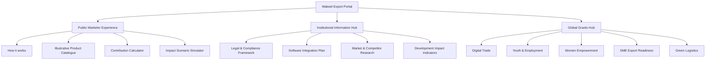

# WAKEEL EXPORT
## الوكالة الوطنية للتصدير التشاركي

**من المنتج المصري إلى الأسواق العالمية، بمشاركة الجميع.**

[العربية](#الرؤية) · [English](#vision) · [Live preview](#deployment)

---

## الرؤية

أن تصبح **وكيل – Wakeel Export** بوابة رقمية رائدة للتصدير التشاركي، تفتح أمام المواطنين المصريين فرصاً سهلة ومنظمة للمساهمة في تسويق المنتجات المصرية للأسواق العالمية، وتربط طاقات الأفراد والمصانع وشركات التصدير والخدمات اللوجستية ضمن منظومة متكاملة تدعم تنافسية المنتج المصري، وتوسّع قاعدة المشاركة في عوائد التجارة الدولية، وتسهم في زيادة الصادرات وتدفقات النقد الأجنبي.

## الرسالة

تمكين الأفراد من المشاركة في تنمية الصادرات المصرية من خلال تجربة رقمية بسيطة وجاذبة، تتيح للمسوق المستقل اكتشاف المنتجات وفرص الأسواق والتواصل التجاري، بينما تتولى الجهات والشركات المرخصة تنفيذ أعمال التصدير والتحصيل والشحن وفق الأطر القانونية والتنظيمية المعمول بها.

## المشكلة والحل

تواجه منتجات ومصانع مصرية عديدة تحدي الوصول المستمر إلى مشترين وأسواق خارجية، بينما يمتلك الأفراد طاقات تسويقية وشبكات علاقات يمكن توظيفها دون تحويلهم إلى مصدرين قانونيين. تقدم Wakeel تصوراً رقمياً يفصل بين **التسويق المستقل** و**التنفيذ التصديري المرخص**، ويربط المصانع بالمسوقين وشركات التصدير وشركاء الخدمات.

## ما الذي تتضمنه الواجهة؟

- **بوابة جماهيرية للمسوق:** رحلة مشاركة مبسطة، أربع خطوات، حاسبة توضيحية للمقابل المقترح بنسبة 0.5%، وكتالوج استرشادي.
- **الكتالوج:** أمثلة لفئات منتجات مصرية؛ لا تظهر كعروض فعلية إلا بعد اعتماد المورد والتحقق من المستندات والمواصفات.
- **اللوجستيات:** شرح LCL Consolidation وExpress، دون اختلاق حجوزات أو مواعيد شحن فعلية.
- **محاكي الأثر القومي:** سيناريو حسابي يستند إلى خط أساس تخطيطي قدره 45 مليار دولار وسيناريو نمو قابل للتعديل. يجب توثيق رقم الأساس وسنته من مصدر حكومي رسمي قبل استخدامه كإحصاء.
- **بوابة المعلومات المؤسسية:** الرؤية، الامتثال القانوني، التكامل البرمجي، أبحاث الأسواق والمنافسين، الأثر المجتمعي، تمكين المرأة ومؤشرات التنمية.
- **Wakeel Global Grants Hub:** خريطة أولية للجهات الدولية ذات الصلة المحتملة، مع روابط مواقعها الرسمية وتصنيفها حسب محور التنمية.

## محاور المنظومة

1. **بوابة المسوق المستقل:** واجهة سهلة الاستخدام، رحلة تسجيل مبسطة، اكتشاف المنتجات، متابعة الفرص والمساهمات.
2. **بوابة المصانع والمنتجات:** بيانات المنتجات والمواصفات والأسعار والجاهزية التصديرية والطلبات.
3. **التشغيل والتكامل:** التنسيق مع شركات التصدير المرخصة والبنوك وشركات الشحن ومقدمي الخدمات.
4. **الامتثال والتقنين:** مراجعة قانونية متخصصة للعقود والإجراءات وتوزيع المسؤوليات، واستكمال الموافقات اللازمة قبل التشغيل الفعلي.
5. **أبحاث الأسواق:** رصد الأسواق والطلب والمنافسين والاشتراطات وفرص النفاذ بصورة مستمرة.
6. **الأثر والشراكات الدولية:** قياس النتائج التنموية ورصد فرص المنح والتعاون الدولي والتحقق من الأهلية.

## معمارية الواجهة

## التقنية

- HTML5 semantic markup.
- Tailwind CSS via official Play CDN for this no-build prototype.
- Vanilla JavaScript for bilingual switching, navigation panel, calculators and grant filters.
- Google Fonts: Cairo and Inter.
- No framework, backend, database, paid API, API key, or build step.
- Inline SVG flag-inspired identity mark; the gold eagle-like mark is a **decorative illustration**, not a reproduction or claim to be the official Egyptian coat of arms.
- RTL Arabic by default, with an English LTR interface toggle.
- Responsive layout, keyboard-accessible controls, reduced-motion preference, and no external image dependencies.

### External runtime dependencies

The page is a single static HTML file. Tailwind Play CDN and Google Fonts are loaded from their public CDNs, so they require an internet connection when the page is opened. No API keys or paid services are required. For a fully offline deployment, replace Tailwind CDN utilities with compiled static CSS and bundle licensed font files; that is intentionally outside this zero-build MVP.

## Quick start

1. Open `index.html` directly in a modern browser, or serve the repository with any static web server.
2. No package installation or build command is required.
3. To publish on GitHub Pages:
   - Open repository **Settings → Pages**.
   - Select **Deploy from a branch**.
   - Choose the branch containing this version and the `/` (root) folder.
   - Save, then wait for GitHub Pages to publish the site.
4. The public URL will follow the repository's GitHub Pages address once enabled.

## Deployment

The portal is a static GitHub Pages-ready prototype. It does not currently provide live registration, e-KYC, payments, banking settlement, customs filing, shipment booking, live product inventory, grant application submission, or a connected backend. Those functions require approved partners, legal arrangements, and separate implementation.

## Global Grants Hub — qualification note

The listed institutions (World Bank Group, IFC, GIZ, UNDP, ILO, UN Women, EBRD, European Union, Afreximbank, GEF and AfDB) are **potential sources of programmes, technical assistance, partnerships or funding pathways**, not confirmed grant awards or verified open calls for Wakeel. Every opportunity must be checked against the current official call, country and applicant eligibility, legal applicant requirements, deadlines, co-financing, and implementation-partner rules. The website links to official institutional domains; it does not claim an active funding window.

## Important pilot and compliance boundaries

- Independent marketers contribute to marketing only; they are not represented as legal exporters.
- Export execution, export documentation, foreign-currency collection, settlement and shipping must be performed by appropriately licensed and authorized entities under applicable rules and agreements.
- The proposed 0.5% contribution amount is illustrative and subject to approved contracts, proof of contribution, and legal and tax treatment.
- LCL is presented as physical cargo consolidation with separate legal and customs records per exporter, subject to the approved procedures and relevant authorities.
- The USD 45 billion baseline and 5% scenario are planning inputs, not verified current official statistics or guaranteed national outcomes.
- Product cards, shipping cadence and participant figures are illustrative until connected to verified suppliers and service providers.
- The grants hub is a research and opportunity-mapping concept; no funding or eligibility is guaranteed.
- This is an independent initiative concept submitted for consideration by the TradeTech Sandbox. The site is not an official government portal and does not imply government endorsement or approval.

## Proof of Concept & Enterprise Customization Readiness

**Status:** Frontend MVP / static concept portal.

**Included:** Bilingual responsive UI, citizen-facing journey, illustrative contribution calculator, adjustable national-impact scenario, sample product categories, shipping-model explainer, institutional information panel, donor-category filters, and authorship notice.

**Next validation gates:** Confirm the official export baseline and reference year; validate product and supplier data; review the marketer/exporter contractual model with specialist counsel; confirm customs and LCL procedures with relevant authorities; validate banking and settlement flows with the selected bank; replace placeholder contact details; and verify current grant calls and applicant eligibility.

**Enterprise customization readiness:** The interface is structured into clear content sections and isolated Vanilla JS behaviours, making it straightforward to connect approved APIs and partner systems later without committing the MVP to a framework or paid infrastructure.

## Changelog

### 2026-11-19
- Added the first bilingual Wakeel Export portal in `index.html`.
- Added public marketer journey, contribution calculator, product-category examples, and LCL/Express information.
- Added adjustable export-growth and community-participation scenario simulator.
- Added institutional side panel and the categorized Global Grants Hub.
- Added clear prototype, legal, funding and data-verification disclaimers.
- Updated deployment, architecture, technology and readiness documentation.

---

## Intellectual Property & Authorship | الملكية الفكرية وحقوق التأليف

**Concept, Vision, and Project Authorship:**

**المهندس/ علي حسين زوبير**  
**Aly Hussein Zopair**

© 19 November 2026 — All rights reserved.

تُنسب فكرة المبادرة ورؤيتها ومحتواها التأسيسي إلى صاحب الحقوق المذكور أعلاه. لا يجوز نسخ أو إعادة نشر أو استغلال هذا المحتوى أو استخدامه تجارياً، كلياً أو جزئياً، دون إذن كتابي مسبق، مع مراعاة الحقوق والتراخيص المستقلة لأي مكونات أو أدوات أو أعمال مفتوحة المصدر مستخدمة في المشروع.

**Submission context:** An initiative concept submitted to the TradeTech Sandbox at Egypt's Ministry of Investment and Foreign Trade. This attribution does not imply official government endorsement, approval, or partnership.

---

## Vision

To make **Wakeel Export** a leading digital gateway for participatory exporting—enabling people across Egypt to contribute to marketing Egyptian products to global markets through a simple, accessible, and organized experience. Wakeel aims to connect individuals, manufacturers, licensed exporters, financial institutions, and logistics partners in an integrated ecosystem that strengthens Egyptian product competitiveness, broadens participation in international trade, and supports export growth and foreign-currency inflows.

## Mission

To empower independent marketers to help develop Egyptian exports through an accessible digital platform for discovering products and market opportunities, while licensed export entities and authorized partners remain responsible for the regulated execution of export, collection, settlement, and shipping activities.

## Intellectual Property & Authorship

**Engineer / Project Author:**  
**Aly Hussein Zopair**  
**المهندس/ علي حسين زوبير**

© 19 November 2026 — All rights reserved. The original concept, vision and foundational project content may not be copied, republished or commercially exploited without prior written permission, subject to the separate licenses and rights of third-party and open-source components.
