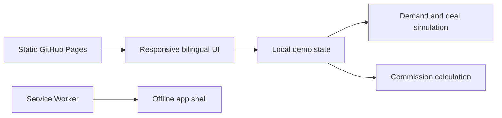

# WAKEEL Export — Interactive Lite Prototype

A silent, bilingual Arabic/English, mobile-first prototype for the proposed participatory export workflow.

## Open
GitHub Pages path: `/prototype/` (once deployment is confirmed), or open `index.html` locally. For offline/PWA behavior, serve over HTTPS or localhost.

## Demonstrated interactions
- Arabic RTL / English LTR language switching.
- Animated Egyptian flag using CSS only.
- Demo demand leads, buyer search, status filters and simulated RFQ creation.
- Supplier matching creates a simulated deal.
- Deal lifecycle: matching → quoted → confirmed → shipped → completed.
- Commission simulator: 0.5% marketer + 0.1% platform.
- Responsive mobile navigation and installable Lite PWA shell.
- Service-worker cache for offline reopening after first successful visit.

## Prototype boundary
All buyers, suppliers, amounts, metrics and workflow events are illustrative. No live buyer verification, KYC, payment, bank, customs, exporter, logistics, marketplace or government integration exists. Demo actions are not commercial transactions or regulatory approval.

## Architecture

## Lightweight implementation
Native HTML/CSS/JavaScript only; no runtime framework, paid API, server, database, analytics or tracking. System font fallbacks avoid remote font dependencies.

**Status:** Proof of Concept — not an operational export platform.

**Authorship:** Aly Hussein Zopair (علي حسين زوبير ALY HUSSEIN ZOPAIR)
